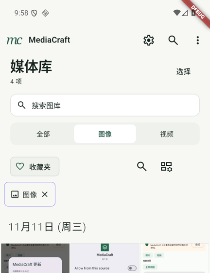
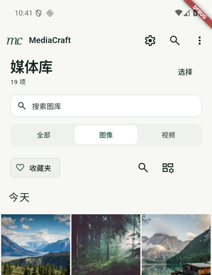

# 操作后界面布局排查与验证

验证时间：2026-11-17 至 2026-11-18，Asia/Shanghai。发布候选版本：`0.6.5+189`。

## 用户问题与验收条件

用户澄清的复现操作是媒体首页点击顶部“照片/图像”分类。分类控件已经表达了筛选条件，但收藏区域下方又出现同一个条件，新增一行并推动媒体内容下移。本轮按这一操作状态问题排查全局相关布局、异步回调及返回流程。

验收要求：快捷筛选只表达一次；额外条件和选择器范围不丢失；选择、字体、尺寸及页面返回后，实际布局与操作坐标同步；查看器、编辑器、搜索和地图的延迟任务不干扰离场后的页面。

## 首页复现与修复

在 `MediaCraft_API36` 模拟器，1080 × 2400、density 420 下，修复前首页页头底边为 `y=922`。点击“图像”后，重复筛选行让底边变为 `y=1080`。

修复只调整 `CollectionAppBar` 的条件呈现：普通首页不再把已由分类或收藏快捷控件表达的条件放进第二条 FilterBar。相册、评分等额外条件仍显示；没有首页快捷控件时继续显示完整范围，实际 `CollectionLens.filters` 没有被删减。

| 修复前 | 修复后 |
| --- | --- |
|  |  |

新版百度 Debug 包实际操作“图像 → 视频 → 全部 → 收藏打开 → 收藏关闭”时，页头底边始终为 `y=922`，各快捷条件标签仅出现一次。测试集合数量依次为 19、1、20、0、20；后续为重复复核新增一份测试副本后，集合为 21 项。

## 全局修复范围

| 领域 | 修复内容 |
| --- | --- |
| 图库、相册和标签 | 依赖、字体及窗口变化后，在下一帧同步页头高度；手势命中、缩放、条目追踪和滚动条使用与 Sliver 一致的高度 |
| 查看器底栏 | 监听选择模式，及时替换浏览操作条与选择条 |
| 查看器显隐 | 合并尚未执行的过时目标；平台请求和动画有当前目标检查；离场关闭协调器，等待在途系统栏请求后恢复普通页面 |
| 系统栏恢复 | 离场显式恢复系统栏，不依赖可能滞后的可见性通知；浏览页样式覆盖顶部安全区，浅色页面恢复深色图标 |
| 查看器移除最后一项 | 先完成离场清理再退出，跳过已经没有目标条目的关闭 Hero |
| 编辑器 | 返回键门禁随活动工具更新，先取消工具，再退出编辑器 |
| 地图 | 销毁时取消信息 debounce，并保护 post-frame 和 notifier 更换流程 |
| 集合搜索 | 快速重复选择只安排一次关闭；临时弹层覆盖时不误退弹层，回到搜索后仍可继续选择 |
| 设置 | 查询、字体和窗口变化复用条目加载；语言及 TV 模式变化时失效重载，保留滚动状态 |

没有修改最初怀疑的编辑器 Stack 尺寸算法：Flutter 的 `Positioned(key, child)` 在所有定位参数为空时仍参与 Stack 尺寸计算，原实现不是缺陷。

## 本地模拟器操作记录

仅操作本轮启动的 `emulator-5554` / `MediaCraft_API36` 只读实例，Android API 36、x86_64。所有 ADB 命令均显式指定该序列号，没有操作连接的实体手机。

| 页面或状态 | 实际操作与结果 | 本地证据文件 |
| --- | --- | --- |
| 首页快捷筛选 | 图像、视频、全部、收藏开关连续切换，标签不重复、数量正确、页头高度不跳动 | `home-interaction-verification.json`、`final-home-*.png` |
| 选择与取消 | 选择一项后操作条显示 1 项，返回恢复浏览态 | `final-selection-one.json/png` |
| 相册 | 动态相册、相册组、全部相册切换；进入测试相册再选图像，保留相册条件且不重复显示图像条件 | `final-albums-*.png`、`final-album-photos.json/png` |
| 字体与横竖屏 | 运行中改为 1.5/2.0 倍系统字体，切换分类及横竖屏；横屏可滚动访问内容，回竖屏后页头恢复 | `final-large-text*.png`、`landscape-after-scroll.json/png`、`final-portrait-return.json` |
| 照片查看器 | 十次连续单击显隐，最终编辑、分享、信息、删除按钮各一份且位置与切换前一致；详情可进入返回 | `viewer-before-rapid.json`、`viewer-after-rapid.json/png`、`final-info.png` |
| 编辑器 | 进入转换工具，第一次系统返回仍留在编辑器并恢复“保存副本”；第二次退出，未保存媒体 | `final-editor-transform.png`、`final-editor-first-back.json/png` |
| 视频 | 实际打开 2 秒测试视频，播放状态切换为暂停按钮，进度与菜单可显示，关闭菜单可返回图库 | `final-video-start.json/png`、`final-video-played.json`、`final-video-menu.png` |
| 设置 | 设置分类滚动后改字体和横竖屏；搜索输入后仍显示真实结果，可返回原页面 | `final-settings-scrolled.png`、`final-settings-landscape.png`、`final-settings-search.json` |
| 地图 | 普通及卫星百度底图实际加载；缩略条滑动后退出，未出现释放后回调错误 | `final-map-baidu.png`、`final-map-satellite.png` |
| 重复清理 | 空结果、一组重复、改保留项后选择归零、再次勾选和取消确认；测试文件字节未改变 | `final-duplicates-*.json/png`、`cleanup.json` |
| 统计和文件夹 | 使用真实集合进入并返回，页面及导航正常 | `final-stats.png`、`final-explorer.png` |
| 外部选择器 | GET_CONTENT 多选请求可进入、选择一项、取消；没有维护工具入口 | `final-picker-start.json/png`、`final-picker-selected.json/png` |
| 锁定查看器返回 | 锁定后立即返回，等待 6 秒，图库系统栏仍显示；最终包的浅色状态栏为深色图标，页头底边保持 `y=922` | `release-candidate-locked-back.json/png`、`release-candidate-exit-verification.json` |
| 普通查看器返回 | 从真实视频查看器返回，系统栏可见且图标为深色，布局恢复 | `release-candidate-ordinary-viewer.json`、`release-candidate-ordinary-back.json/png` |
| 最后一项移除与恢复 | 单文件相册从查看器移入回收站后安全返回 0 项集合；样本恢复后回收站为 0 项 | `exit-after-last-item-removed.json/png`、`exit-bin-restored.json`、`exit-interaction-verification.json` |

最终百度 Debug 包构建成功并完成上述返回复核；首页再次执行“图像 → 视频 → 全部 → 收藏打开 → 收藏关闭”，集合数量依次为 4、1、5、0、5，页头底边均为 `y=922`，标签没有重复。该轮证据单独保存为 `release-candidate-home-*.json/png` 和 `release-candidate-home-verification.json`，保留首轮样本集合的原始记录。最终包及 SHA-256 记录为 `MediaCraft-0.6.5-layout-baidu-release-candidate-debug.apk`、`debug-package-sha256.json`，构建日志为 `build-baidu-release-candidate.log`。

上述文件位于 `artifacts/prototype-fidelity-2026-11-17/`，受现有 `.gitignore` 忽略，验证脚本保存在 `.tooling/prototype-fidelity-2026-11-17/`。

## 自动验证

最终默认 libre 配置下，主应用、测试和当前启用插件的静态分析为 0 issues，完整 Flutter 测试 159 项通过。挂载后动态修改 TextScaler 的回归曾先观察到 Sliver 高度 `335.18`、缓存高度 `301` 的不一致，修复后两者一致。针对搜索弹层覆盖、重复弹栈、地图销毁、真实设置滚动和查看器/编辑器状态的定向测试均通过。

新增状态栏测试直接检查真实 AppBar 在顶部安全区采样点的样式：修复前为 `null`，修复后推入深色页面再返回时为深色图标。退出恢复的生产函数测试在修复前观察到旧可见值导致恢复调用次数为 0；修复后始终发送恢复请求，重复或迟到的隐藏通知不提前完成离场。最终日志为 `analyze-release-candidate.log`、`flutter-tests-release-candidate.log`。正式百度包由该标签的双 flavor GitHub Actions 门禁与构建流程生成，并单独核验签名、ABI、SDK/runtime 和 SHA-256，远端执行结果以该标签 Actions 和发布附件核验记录为准。

## 验证边界与已知现象

- 外部 Picker 对调用方 MIME 类型的约束在 `home_page.dart` 中仍有既有 TODO；本轮验证其布局、选择、取消及维护入口限制，不宣称补齐该业务能力。内部固定条件范围有独立回归覆盖。
- 首次打开旧模拟器数据库时，18 条已删除测试媒体的置顶缓存短暂产生缩略图缺失错误，随后 obsolete 检查将其清理；重新启动后不再出现。`extent=0` 是原生默认缩略图尺寸的合法约定，不应据此改动解码链。
- 调试日志仍包含 leak_tracker 的 GC 统计；构建保留依赖的 Java 8/Gradle 弃用和既有未翻译提示，没有将构建通过表述为无警告。
- 未做新正式签名包的实体设备验收、TV 遥控、全部格式、DLNA、所有外部编辑器及全部地图服务兼容性验证。

## 资源与隔离

首轮清理 17 个本次样本及对应索引，共 1,456,671 字节；原有 4 项媒体 ID/路径集合保持一致，所有样本在清理前的 SHA-256 与源文件一致。只读模拟器实例已停止。首轮中间构建产物清理约 4.08 GB，恢复 libre 依赖后仅重建约 37 KB 的生成记录。

补充退出回归的单个样本、独立目录及索引已清理，只读模拟器已确认停止，原有 4 项媒体 ID/路径保持一致。样本在移入回收站前触发既有 `checkUndatedItems` 流程，将文件时间写为 XMP 拍摄日期：文件从 17,166 字节变为 19,366 字节，完整文件哈希发生变化，视频 `mdat` 数据区 SHA-256 完全一致。该差异及恢复后副本保存在 `exit-fixture-content-verification.json`、`exit-probe-after-restore.mp4`，不宣称此样本完整字节未变。最终回归日志未出现布局、释放后访问或 Future 重复完成错误，清理记录为 `exit-cleanup.json`。

最终清理前构建目录约 3.84 GB，`flutter clean` 后恢复默认 libre 依赖，仅重新生成 37,110 字节本地化元数据。两个已被最终候选取代的 Debug 包共 896,851,102 字节，删除操作被自动审批以“blocked by policy”拒绝，因此保留并记录于 `host-cleanup-final.json`。正式包、校验文件、截图、日志和验收脚本按审计与复现用途保留；历史正式版本继续用于升级与签名基线核对。
