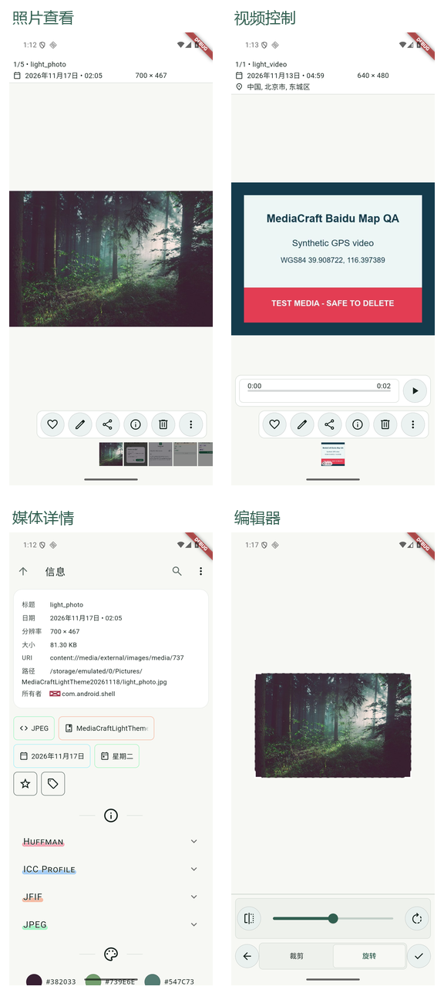

# 媒体浅色界面与设置首页验证

验证日期：2026-11-18，Asia/Shanghai。候选版本：`0.6.6+190`。

## 用户反馈与调整范围

用户安装使用后反馈：点击照片或视频进入查看时，编辑操作栏和详情页仍为深色，背景层次杂乱。本次将这些媒体区域统一为浅色纸面背景、白色实底面板和深色文字图标，沿用绿色强调色。

查看器和内置编辑器复用项目已有浅色主题工厂，并在浅色主题内重新建立语义颜色 Provider。照片操作栏、视频控制条和顶部信息栏不再各自覆盖深色主题。详情页及卡片继承同一浅色主题，弹出菜单和状态栏也采用对应的浅色样式。面板不透明，避免媒体画面颜色透入工具栏。

从应用深色主题进入这些区域时也保持浅色。裁剪遮罩、字幕、视频手势反馈及图像内容保持其用途对应的绘制方式。

另移除移动版设置首页正文的搜索卡片和间距，分类列表直接显示。标题栏的搜索入口保留。

## 自动验证

- 主应用、测试及当前启用插件的静态分析：0 issues。
- 完整 Flutter 测试：163 项通过。
- 新增 4 项浅色意图回归：外层深浅主题、真实照片/视频操作栏、空数据详情页、菜单和状态栏样式、语义颜色边界。
- 真实截图包含 14 个像素采样点，确认纸面背景为 `#f7f8f4`、面板/卡片/菜单为不透明白色；深色首页与其后进入的浅色媒体页分别有独立截图证明。
- 默认 libre 的 x86_64 Debug APK 构建成功，版本为 `0.6.6+190`。

日志与截图保存在 `artifacts/light-viewer-2026-11-18/`，受既有 `.gitignore` 忽略。关键记录为 `analyze.log`、`flutter-tests.log`、`build-libre-debug.log`、`screenshot-verification.json`。定向测试日志为 `artifacts/media-viewer-light-theme-test.log`。

## 本地模拟器验收

环境：`MediaCraft_API36`、Android API 36、x86_64，1080 × 2400、density 420。仅操作本次启动的 `emulator-5554` 只读实例，所有 ADB 操作显式指定该序列号，未操作连接的实体手机。

| 区域 | 实际操作与结果 | 证据文件 |
| --- | --- | --- |
| 照片查看 | 从首页图像分类打开真实 JPEG，画布为浅纸色，编辑等操作位于白色面板，文字和图标为深色 | `photo-viewer.json/png` |
| 照片菜单 | 打开更多菜单，白色菜单背景与深色文字、图标可读 | `photo-menu.json/png` |
| 视频查看 | 打开 2 秒 MP4，控制条和进度条为浅色；点击播放后控件实际切换为“暂停” | `video-viewer.json/png`、`video-played.json` |
| 视频菜单 | 展开更多菜单，菜单为白色 | `video-menu.json/png` |
| 详情 | 分别进入 JPEG 与 MP4 信息页，纸面背景、白色基础信息卡片和深色文字正常 | `photo-details.json/png`、`video-details.json/png` |
| 内置编辑器 | 经实际 EDIT Intent 打开 JPEG，进入转换/裁剪工具，再返回取消；底栏与画布为浅色，未保存副本 | `editor-start.json/png`、`editor-transform.json/png`、`editor-tool-cancelled.json` |
| 深色入口 | 在设置中切为深色，确认首页变深；再打开照片、详情和内置编辑器旋转工具，这些媒体区域仍为浅色，状态栏图标为深色 | `dark-home.png`、`photo-from-dark.png`、`details-from-dark.png`、`editor-rotate-from-dark.json/png` |
| 设置首页 | 正文无搜索栏，首项为“导航”。打开该分类后可以返回；右上角放大镜仍能打开并聚焦“搜索设置”输入框 | `settings-without-search-bar.png`、`settings-resume-back-to-index.json`、`settings-resume-search.png`、`settings-resume-verification.json` |

设置验收安装了包含两项调整的最终调试包，SHA-256 见 `debug-package-sha256.json`。首次启动遇到 Android 系统界面无响应弹窗，点“等待”后恢复并通过设置首页检查；后续只读冷启动补验返回和搜索入口。

本地验收使用默认 libre，视频详情的地图区域不作为百度底图加载验收。正式百度包由 `v0.6.6` 标签工作流执行双 flavor 门禁并构建，随后核验版本、包名、ABI、百度 SDK、运行库、签名、校验文件与构建来源；远端结果以对应 Actions 和 `artifacts/github-release/baidu-0.6.6/` 为准。本次没有实体设备或全部 Android 版本、格式、慢动作/A-B 循环的逐项兼容性验收。

## 清理与保留

测试 JPEG、MP4 两个样本共 100,419 字节，清理前 SHA-256 与源文件一致；样本、独立目录和索引已移除，原有 4 项媒体 ID/路径集合保持一致。只读模拟器已确认停止，AVD 定义保留。日志未发现布局溢出、释放后访问或 Future 重复完成错误，记录为 `cleanup.json`。

设置验收未导入测试样本，复对原有 4 项媒体的 ID 和路径无变化，只读实例已停止。全量系统日志包含快照中旧应用进程的 5 条布局警告；按本次应用启动进程筛选，未发现布局或生命周期异常。证据为 `settings-resume-app-logcat.log`、`settings-resume-cleanup.json`。

最终调试包归档并重验 SHA-256 后，`flutter clean` 移除构建输出。`flutter pub get --enforce-lockfile` 恢复默认 libre 配置，根 YAML 和锁文件与 libre 快照一致，服务实现指向 `aves_services_none`，构建目录仅重新生成 37,110 字节本地化元数据。源码、AVD 定义、最终调试包、截图、日志、脚本和签名基线按开发、复测和发布用途保留，记录为 `settings-host-cleanup.json`。
